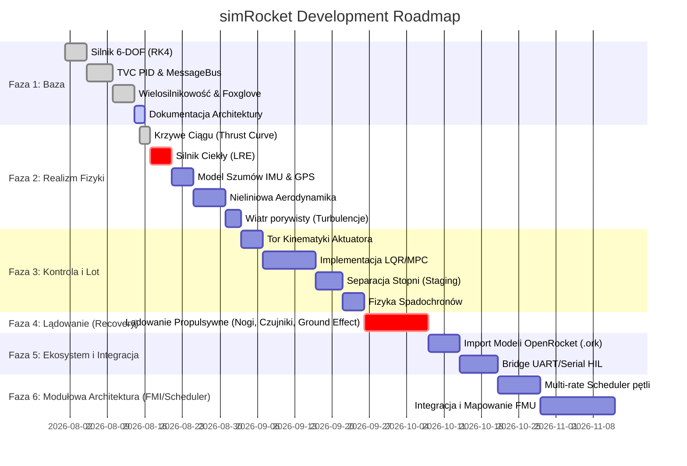

# simRocket - Project Dashboard & Roadmap

Ten dokument pełni rolę "Single Source of Truth" (Głównego Źródła Prawdy) dla Product Ownera. Pozwala na śledzenie ukończonych kamieni milowych, obecnych prac oraz planowanie przyszłych funkcjonalności frameworka `simRocket`. Został przygotowany w oparciu o wizualizacje (Kanban / Gantt), które można na bieżąco uaktualniać.

## Aktualizacja 2026-10-20 — architektura komponentów

Uzgodniono uproszczenie konfiguracji wokół komponentów i interfejsów.
Logic/controller models wymieniają informacje przez idealną szynę;
plant models otrzymują sterowanie i wymieniają wielkości fizyczne przez
bezpośrednie porty. FMU jest alternatywną implementacją komponentu.

- [x] Uzgodnienie kierunku architektury.
- [x] Specyfikacja kontraktów interfejsów i semantyki czasu/zdarzeń ([v1](docs/interface_contracts.md)); wdrożenie runtime w kolejnych etapach.
- [x] Przykłady nowego formatu z wymiennym natywnym IMU/FMU ([opis](examples/component_config/README.md)); uruchamialne przez loader.
- [x] Loader konfiguracji, walidacja i adaptery presetu rocket-tvc/v1 ([zakres i ograniczenia](docs/scenario_loader.md)).
- [x] Idealna szyna, porty direct i fazy dla presetu rocket-tvc/v1 ([zakres](docs/component_runtime.md)); ogólny graf i rozdzielenie wnętrza dynamiki w kolejnym etapie.
- [x] Etap 5a: wydzielenie runtime, fabryki silników/aktuatorów i pętli poza main.cpp.
- [x] Etap 5b: oddzielenie dynamiki od napędu i kompozycji modeli fizycznych przez IDynamicsPhysics.
- [ ] Dalsza generalizacja: składanie dowolnego grafu z YAML i publiczne porty pozostałych modeli fizycznych.

Szczegóły: [architektura komponentów](docs/component_architecture.md).
Konkretne magistrale i HIL pozostają późniejszym etapem.

## Aktualizacja 2026-09-05

- Scheduler oraz FMI 2.0 Co-Simulation/Real zostały wdrożone wraz z testami.
- Sensory IMU/GPS, znaczniki czasu i podstawowa kompensacja opóźnienia GPS istnieją.
- Opis działania i ograniczeń: [Integracja FMU](docs/fmu_integration.md).
- Pozostałe diagramy poniżej są historycznym planem. „Zaimplementowane” nie oznacza
  jeszcze walidacji fizycznej ani zgodności ze wszystkimi eksporterami FMI.
- Do dalszej weryfikacji: sprzężenie zmiennej masy z RK4, pełne opóźnienia EKF,
  zewnętrzne FMU z docelowego narzędzia; do rozbudowy: inne typy FMI, HIL i fabryka modeli.

## 📊 Tablica Kanban (Przegląd Modułów)

```mermaid
kanban
  Todo
    [Landing] Symulacja lądowania (nogi, lidary, ground effect)
    [Sensors] Modelowanie szumów IMU (bias, drift) oraz opóźnień GPS
    [Aerodynamics] Nieliniowy profil oporu (Mach dependency) i wiatr porywisty
    [Control] Zaawansowane algorytmy kontroli (LQR / MPC)
    [Hardware] HIL (Hardware-in-the-Loop) - bridge UART/Serial dla fizycznego FMU
    [Mechanics] Kinematyka odwrotna aktuatorów (geometryczne ramię serwa)
    [Staging] System separacji stopni i odzysku (spadochrony)
    [Integration] Import geometrii i parametrów z OpenRocket (.ork)
    [Architecture] Multi-rate Scheduler (definiowalna kolejność i częstotliwość)
    [Architecture] Standard FMI/FMU i mapowanie interfejsów układów logicznych
  In Progress
    [Documentation] Szkielet dokumentacji Markdown dla modułów i architektury
  Done
    [Propulsion] Silniki na paliwo ciekłe (LRE) - Przepustnica, Ciśnienie komory i dynamiczne CG
    [Propulsion] Zmienne krzywe ciągu (Thrust Curves zamiast stałej siły)
    [Architecture] Zdarzeniowy MessageBus (Publish/Subscribe)
    [Physics] Pełna dynamika 6-DOF (RK4 i Euler)
    [Propulsion] Modułowe interfejsy silników i wspracie dla klastrów (np. 33 silniki)
    [Control] Modułowy TvcMixer i kontroler PID
    [Telemetry] Dynamiczny binarny payload UDP 
    [Visualization] Markery Foxglove Studio (Rakieta, Ciąg, Siły, Środki ciężkości)
```

## 📅 Harmonogram Rozwoju (Roadmapa Gantta)

Poniższy wykres prezentuje propozycję priorytetyzacji nadchodzących zadań pogrupowanych w konkretne domeny. Ramy czasowe mają charakter orientacyjny (są jednostkami relatywnymi).



## 📋 Szczegółowy Backlog (Task List)

> [!TIP]
> Jeśli chcesz zainicjować pracę nad jednym z poniższych zadań, skopiuj jego fragment i wyślij w kolejnej wiadomości.

### 1. Zwiększenie realizmu napędu (Thrust Curves) - UKOŃCZONE
- [x] Zastąpienie stałej wartości ciągu `thrust_n` możliwością zdefiniowania pliku CSV (.eng) z charakterystyką ciągu w czasie (np. pliki Rasp).
- [x] Dynamiczne liczenie spalania masy na podstawie integralnej krzywej ciągu.

### 1.5 Silniki na paliwo ciekłe (Liquid Rocket Engines) - UKOŃCZONE
- [x] Zbudowanie klasy `LiquidEngineModel` ze wsparciem dla przepustnicy (Throttle 0-100%).
- [x] Odbieranie komend ciągu przez MessageBus (pozwala to na sterowanie przepustnicą przez kontroler lotu).
- [x] Symulacja ciągu w zależności od ciśnienia atmosferycznego ($P_a$) - wsparcie dla Sea-Level vs Vacuum.
- [x] Budowa klasy `DynamicMassModel` i definicja wirtualnych zbiorników cylindrycznych: poprawna zmiana tensorów bezwładności i CG w trakcie ubywania paliwa.
- [ ] **[Backlog]** Dodanie modelu opóźnień dynamiki turbopomp (np. First-Order Lag) przy zmianie przepustnicy.

### 2. Prawdziwe sensory (Sensor Noise Modeling)
- [ ] Dodanie do szyny wiadomości (MessageBus) klas sensorów.
- [ ] Zaimplementowanie zjawiska `Random Walk`, `Bias instability` dla żyroskopu i akcelerometru.
- [ ] Opóźnienia i spadek częstotliwości (np. 10 Hz) odczytów GPS względem rzeczywistej dynamiki (1000 Hz).

### 3. Złożona aerodynamika i środowisko (Complex Aero & Environment)
- [ ] Obliczanie współczynnika oporu ($C_d$) i siły nośnej w zależności od aktualnej liczby Macha.
- [ ] Przewidywanie przesunięcia środka parcia (COP) przy lotach naddźwiękowych.
- [ ] Dodanie modułu wiatru, który generuje stochastyczne podmuchy (np. model Drydena) zamiast jednorodnego strumienia.

### 4. Kinematyka serw (Actuator Kinematics)
- [ ] Dodanie kinematyki odwrotnej (odległości fizycznych orczyków, pushrodów i łożysk sferycznych) do klasy `TvcActuatorModel`.
- [ ] Wprowadzenie opóźnień odpowiedzi serwomechanizmu (funkcja przejścia LTI drugiego rzędu) oraz fizycznych limitów momentu obrotowego.

### 5. Architektura rakiet wielostopniowych (Staging & Parachutes)
- [ ] Rozszerzenie dynamicznych modeli o listę ciał (Bodies), z możliwością usunięcia ich z drzewa fizyki (Separacja).
- [ ] Dynamiczne otwieranie spadochronów - nowy współczynnik $C_d$ modyfikowany warunkowo po osiągnięciu apogeum.

### 6. Lądowanie Propulsywne (Propulsive Landing)
- [ ] Wprowadzenie modelu fizycznego kontaktu z podłożem (rozszerzenie `SimpleEnvironmentModel`).
- [ ] Dodanie dedykowanych czujników ułatwiających lądowanie (np. LiDAR dla altimetrii, radar).
- [ ] Rozszerzenie aerodynamiki o efekt przyziemny (Ground Effect).
- [ ] Mechanika rozkładanych nóg (skokowe zwiększenie oporu aerodynamicznego, przesunięcie CG/COP, kinematyka podwozia).
- [ ] Kontroler naprowadzania na lądowisko (np. mG-FOLD) operujący na przepustnicy (Throttle).

### 7. Sprzętowa pętla symulacyjna (Hardware-in-the-loop - HIL)
- [ ] Stworzenie węzła / wrappera (np. dla protokołu MAVLink), który zamiast przesyłać dane do wewnętrznego kontrolera, wypycha dane z symulacji na port szeregowy / UART.
- [ ] Możliwość uruchomienia kodu z mikrokontrolera z realnymi opóźnieniami systemowymi.

### 8. Import i Ekosystem Zewnętrzny (External Tools)
- [ ] Zbudowanie parsera plików `.ork` (OpenRocket) - rozpakowywanie archiwum i parsowanie pliku XML.
- [ ] Automatyczny ekstraktor parametrów: sucha masa, tensor bezwładności, pozycja CG, wymiary i współrzędne COP.
- [ ] Skrypt generujący plik `config.json` z modelu OpenRocket jako punkt wyjścia dla użytkownika.

### 9. Multi-rate Scheduler i Kolejność Pętli
- [x] Wydzielenie harmonogramu (Scheduler); dalszy podział `main.cpp` pozostaje w backlogu.
- [ ] Możliwość zdefiniowania przez użytkownika częstotliwości wykonania danego modułu (np. fizyka 1000 Hz, IMU 800 Hz, GPS 10 Hz, kontroler 100 Hz).
- [ ] Korekta kolejności: Zbieranie sił zewnętrznych/wewnętrznych -> Sumowanie wektorów -> Całkowanie fizyki (Dynamics na samym końcu cyklu).

### 10. Modułowe Interfejsy i FMI/FMU (Component Mapping)
- [x] Rejestr sygnałów i mapowanie portów Real dla FMU; natywne modele mają adaptery wybranych sygnałów.
- [ ] Obsługa standardu FMI (Functional Mock-up Interface) dla elementów C/C++ i prekompilowanych modeli binarnych.
- [ ] Stworzenie menedżera mapowania, który potrafi "wpiąć" porty wyjściowe z wirtualnego czujnika do portów wejściowych FMU algorytmu GNC.

## Zaplanowana analiza wydajności — 2026-10-28

- [ ] Zmierzyć czas wykonania względem czasu symulowanego przy wyłączonym
  ograniczaniu do czasu rzeczywistego; porównać build Debug i Release.
- [ ] Profilować osobno dynamikę/RK4, EKF, scheduler i transport, FMU, serializację,
  UDP/mostek ROS oraz zapis JSONL/CSV/MCAP. Porównać przebiegi z telemetrią i bez niej.
- [ ] Sprawdzić skalowanie kosztu z liczbą komponentów i ich częstotliwościami.
- [ ] Dopiero na podstawie profilu zaproponować optymalizacje i sprawdzić ich wpływ
  na deterministyczność oraz wyniki. Obserwacja użytkownika: obecny mały system
  wydaje się liczyć zbyt wolno; przyczyna nie została jeszcze zmierzona.
